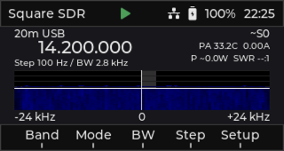

# Square SDR

This project is a receive-only Cardputer Zero application for the Square SDR 2.
It uses OpenHPSDR Protocol 1 over Ethernet for live IQ reception, with USB, LSB,
AM, and CW demodulation, mono-to-stereo audio output, a panadapter, and a
top-to-bottom waterfall. Host-controlled TX, PTT, MOX, and microphone capture
are deliberately disabled. A physical radio PTT may key the radio independently
of this application.

The desktop simulator supports deterministic offline spectrum testing and live
radio testing. Device builds use ALSA for audio and are tuned for the Cardputer
Zero's limited CPU and memory: the live analyzer caches window coefficients,
minimizes time under the IQ-buffer lock, and the device preset compiles out
trace/debug/info logging.

TX support is planned for a future phase, including PTT/MOX control, microphone
input, RF drive, and transmit telemetry. It is intentionally not implemented in
the current receive-only build.

If discovery receives no radio reply, a brief warning appears while discovery
continues retrying. Network discovery errors show a separate warning.

The live waterfall uses an uncalibrated display scale for low-level IQ; its
colors are not calibrated signal-strength measurements. Receive audio uses
automatic gain with a short startup fade and a 2% full-scale output limit.
Keep the device volume low when starting a session and adjust it gradually.
The receiver's approximate S reading uses pre-AGC in-band I/Q power and the
HF convention of S9 = -73 dBm and 6 dB per S-unit. It currently uses a
provisional -80 dBFS S9 reference to better match observed receive levels; it
assumes +20 dB receive gain and a nominal +3 dBm ADC full-scale reference,
neither verified for this radio. It is not a calibrated S-meter. The receiver page shows PA temperature in
degrees Celsius, PA current in amps, estimated power and SWR, and PTT/ADC-overload
alerts. Temperature and current use the nominal Hermes-Lite reference voltage
and have not been calibrated against instruments. Power and
SWR use the Hermes-Lite Thetis reference conversion and are estimates, not
measurements calibrated for this radio. SWR is unavailable below 2 W forward
power or when detector readings are invalid; do not rely on it for protection.
The nominal 5 W output rating is not a hard limit on the reported power.
Measurements clear after one second without valid packets. Mode and bandwidth
changes reconfigure the live receive DSP and restart its short audio fade. AM
bandwidth is the total RF passband; CW bandwidth is centered on the tuned
signal, with a 700 Hz beat note.

For the Square SDR 2's N2ADR-style filters, live receive uses the Hermes-Lite
Thetis N2ADR preset: 160 m, 80 m, 60/40 m, 30/20 m, 17/15 m, and 12/10 m
share six filter groups. The AM-broadcast high-pass is enabled above 160 m.
Switching between two bands in the same group does not change the low-pass relay.
The radio's low-pass bank is described as transmit-path-only for this model, so
relay movement alone does not establish that reception is filtered.

<p align="center">
  
</p>

<div align="center">
    <h1>Square SDR</h1>
</div>

<div align="center">
  <p>A compact receive-only OpenHPSDR client for Square SDR 2.</p>
</div>

<p align="center" style="margin: 20px 0; display: flex; justify-content: center; flex-wrap: wrap; gap: 12px;">
  
  
  
  
</p>

<p align="center">
  <a href="https://discord.gg/ysQAWBUE9Q">
    
  </a>
</p>

Desktop builds use an SDL hardware-accelerated compositor for fast UI preview, while device builds use the Linux/LVGL platform drivers.

## Project Overview

In this example project, we used small MVVM-style structure around LVGL:

- **UI layer**: screens and widgets are implemented with LVGL objects. `BaseScreen` owns the page root, title bar, nav bar, and page content. Widgets derive from `BaseWidgets` and expose a `build()` entry point.
- **Data model**: `BaseModel` stores application state such as current page, theme mode, receive mode, frequency, band, step, and filter width.
- **View model**: `BaseViewModel` exposes model state as LVGL observer subjects and provides UI actions such as page switching, tuning, and receiver setting changes.
- **Reactive/data binding**: `src/reactive` wraps LVGL observer subjects and common bindings so labels, styles, flags, widget values, and events can be connected to application state.
- **Data flow**: user input triggers widget callbacks, callbacks update `BaseViewModel`, view model publishes subjects, and bound UI objects refresh automatically through LVGL observers.
- **Platform layer**: platform code owns Linux input integration and other hardware-facing services. The nav bar maps hardware/keyboard keys `4` to `8`, plus `ESC` for quit.

## Current UI

- Receiver page: live panadapter/waterfall, signal level, radio telemetry, frequency, band, mode, bandwidth, and tuning step. The panadapter marks the selected passband: USB/CW to the right, LSB to the left, and AM across both sides. `Left`/`Right` or `Z`/`C` tune; holding them repeats.
- Band defaults follow common HF convention: `160m` through `40m` use LSB, `30m` uses CW, and `20m` and above use USB. Selecting a band also restores that mode's default bandwidth.
- Setup page: intentionally blank until settings are implemented. `ESC` returns to the receiver.

## Hardware Validation

The receive path has been tested with a Square SDR 2 and a Cardputer Zero using
a real antenna. A clearly audible 40 m LSB signal from Bulgaria was received in
the UK. Both 3.5 mm headphones and a USB headset produced working receive audio.
Tuning direction and live waterfall movement have also been checked on hardware.
The S-meter and waterfall gain are provisional display calibrations and still
need testing against weaker signals such as FT8.

## Repository Layout

```text
.
├── assets/                 # Runtime assets used by the app
│   ├── audio/              # Audio resources
│   ├── fonts/              # TTF fonts loaded through FreeType
│   └── images/             # Application and launcher images
├── screenshot/             # Simulator screenshots for supported desktop platforms
├── src/
│   ├── app/                # Application lifecycle, asset loading, screen management
│   ├── config/             # LVGL config headers for desktop and device builds
│   ├── logger/             # Project logging wrapper
│   ├── model/              # Base application data model
│   ├── platform/           # Platform input/hardware integration
│   ├── reactive/           # LVGL observer subjects and binding helpers
│   ├── view/               # Theme, UI constants, screens, and widgets
│   │   ├── screens/        # Page-level LVGL screens
│   │   └── widgets/        # Reusable LVGL widgets such as nav bar and icon button
│   ├── viewmodel/          # BaseViewModel and UI-facing actions/state subjects
│   └── main.cpp            # Program entry point
├── CMakeLists.txt          # Build graph, dependencies, options, targets
├── CMakePresets.json       # Desktop/device configure and build presets
└── README.md
```

### Modules

- `src/app/asset_manager.*`: resolves runtime assets from the optional CMake asset root, source tree `assets/`, and installed `/usr/share/<APP_NAME>/` path.
- `src/app/screen_namager.cpp`: switches LVGL screens when the current page subject changes.
- `src/app/desktop_simulator_frame.*`: owns the desktop SDL window, renderer, high-resolution shell textures, input, and LVGL texture composition.
- `src/config/lv_conf_desktop.h`: desktop LVGL rendering settings.
- `src/config/lv_conf_cm0.h`: embedded Linux/CardputerZero LVGL settings.
- `src/platform/linux_input.*`: Linux evdev keypad support and desktop SDL keyboard routing for nav buttons.
- `src/reactive/subjects.*`: typed wrappers around LVGL subjects.
- `src/reactive/bindings.*`: helper bindings for labels, theme, widget values, flags, states, and events.
- `src/view/widgets/navbar.*`: bottom navigation bar and icon-button action mapping.
- `src/view/widgets/icon_button.*`: transparent icon button with font/color/theme support.

## Build Options

Common CMake cache options:

| Option | Default | Description |
| --- | --- | --- |
| `USE_DESKTOP` | `ON` | Build SDL desktop simulator when `ON`; build embedded Linux target when `OFF`. |
| `APP_NAME` | `square-sdr` | Application name used by installed asset lookup. |
| `APP_ASSETS_ROOT` | empty | Optional runtime asset root. Expected layout includes `fonts/`, `images/`, etc. |
| `APP_CONFIG_FILE` | platform default | Optional config path. Defaults to `config/square-sdr.conf` for desktop builds and `/etc/square-sdr.conf` for device builds. |
| `APP_KEY_INPUT_DEVICE` | empty | Optional Linux evdev device path, e.g. `/dev/input/event0`. Empty means auto-scan `/dev/input/event*`. |
| `APP_FRAMEBUFFER_DEVICE` | `/dev/fb0` | Linux framebuffer device used by embedded builds when `APP_USE_DRM=OFF`. |
| `APP_USE_DRM` | `OFF` | Use LVGL's Linux DRM/KMS backend instead of fbdev for embedded builds. |
| `APP_DRM_DEVICE` | `/dev/dri/card0` | DRM device path used when `APP_USE_DRM=ON`. |
| `APP_DRM_CONNECTOR_ID` | `-1` | DRM connector id used when `APP_USE_DRM=ON`; `-1` auto-selects. |

Asset lookup order:

1. `APP_ASSETS_ROOT` when provided by CMake
2. source-tree `assets/` for development
3. `/usr/share/<APP_NAME>/` for installed deployments

Theme startup behavior is configured in `config/square-sdr.conf`:

```ini
[application]
dark_mode=yes
```

Set `dark_mode` to `yes` or `no`. The parser also accepts `true`/`false` and `1`/`0`.
Installed device builds use `/etc/square-sdr.conf` as the system default. Changing the theme
with `U` or `I` writes a per-user override to
`$XDG_CONFIG_HOME/square-sdr/square-sdr.conf`, or `~/.config/square-sdr/square-sdr.conf`
when `XDG_CONFIG_HOME` is not set. The per-user file takes precedence on the next launch.

## Desktop Builds

Desktop builds are intended for fast UI development. LVGL renders at the device-native `320x170` resolution, while SDL composites that texture into a hardware-accelerated, high-DPI simulator window with the full-resolution device shell.

Current dependencies info:

| Dependency | Version | Source | Notes |
| --- | --- | --- | --- |
| LVGL | `v9.5.0` | `CMakeLists.txt` FetchContent | Main GUI framework. |
| fmt | `12.1.0` | System package manager or `vcpkg.json` override | Logging and formatted strings. |
| libpng | `1.6.48` | System package manager or `vcpkg.json` override | PNG image decoding support for LVGL. |
| libjpeg-turbo | `3.1.3` | System package manager or `vcpkg.json` override | JPEG image decoding support for LVGL. |
| zlib | `1.3.1` | System package manager or `vcpkg.json` override | Compression dependency used by image libraries. |
| SDL2 | `2.32.54` | System package manager or `vcpkg.json` override | Desktop simulator display and input backend. |
| FreeType | `2.13.3` | System package manager or `vcpkg.json` override | Runtime TTF font rendering. |

> Windows vcpkg installs use the versions above through manifest mode, with the registry baseline pinned in `vcpkg-configuration.json`.

### Linux Desktop

Debian/Ubuntu dependencies:

```shell
sudo apt update
sudo apt install -y \
  build-essential \
  cmake \
  ninja-build \
  libpng-dev \
  libjpeg-dev \
  libfmt-dev \
  libsdl2-dev \
  libfreetype-dev \
  zlib1g-dev
```

> [!NOTE]
> Minimal CMake version is 3.31.0 (in coordinate with Debian 13 trixie), for Ubuntu user you can install latest cmake via `snap`
> and run following cmake command with `/snap/bin/cmake`.


Configure:

```shell
cmake --preset linux-x86-64
```

Build:

```shell
cmake --build --preset linux-x86-64-dbg
# alternatively, you can run release build
# cmake --build --preset linux-x86-64-rel
```

Run:

```shell
./build/linux-x86-64/Debug/square-sdr
# or launch release build
# ./build/linux-x86-64/Release/square-sdr
```

### macOS Desktop

Install the Apple command-line tools:

```shell
xcode-select --install
```

Install dependencies with Homebrew:

```shell
brew install \
  cmake \
  ninja \
  libpng \
  jpeg \
  fmt \
  sdl2 \
  freetype \
  dpkg \
  zlib
```

Configure for Apple Silicon:

```shell
cmake --preset darwin-arm64
```

Build:

```shell
cmake --build --preset darwin-arm64-dbg
# alternatively, you can run release build
# cmake --build --preset darwin-arm64-rel
```

Run:

```shell
./build/darwin-arm64/Debug/square-sdr
# or launch release build
# ./build/darwin-arm64/Release/square-sdr
```

For Intel macOS, use the `darwin-x86-64` configure preset and matching build preset:

```shell
cmake --preset darwin-x86-64
cmake --build --preset darwin-x86-64-dbg
# alternatively, you can run release build
# cmake --build --preset darwin-x86-64-rel
./build/darwin-x86-64/Debug/square-sdr
# or launch release build
# ./build/darwin-x86-64/Release/square-sdr
```

### Windows Desktop

Install CMake and Ninja:

```powershell
winget install Kitware.CMake
winget install Ninja-build.Ninja
```

Install a C++ toolchain. Choose one of the following.

MSVC Build Tools:

```powershell
winget install Microsoft.VisualStudio.BuildTools
```

In the Visual Studio installer, enable **Desktop development with C++** and make sure MSVC and a Windows SDK are selected.

MinGW-w64:

```powershell
winget install BrechtSanders.WinLibs.POSIX.UCRT
```
Alternatively, you can download from [`winlibs`](https://winlibs.com/). 

Install vcpkg:

```powershell
git clone https://github.com/microsoft/vcpkg.git C:\vcpkg
C:\vcpkg\bootstrap-vcpkg.bat -disableMetrics
```

Configure environmental variables for current terminal:

```
$env:VCPKG_ROOT="C:\vcpkg"
$env:PATH="$env:VCPKG_ROOT;$env:PATH"
```

> [!TIP]
> Change `VCPKG_ROOT` to your vcpkg installation directory if it is located elsewhere.
>
> These environment variables are **session-scoped**, meaning they only apply to the current terminal session.
> Once the terminal is closed, the variables will be lost and need to be set again in a new session.
> If you want to a persist environment variable
> ```powershell
> setx VCPKG_ROOT "C:\vcpkg"
> ```


Configure and build with MSVC:

> [!IMPORTANT]
> These steps require launching CMake from a **Developer Command Prompt** or **Developer PowerShell** provided by Visual Studio.
>
> This ensures that the MSVC environment (compiler, linker, and Windows SDK paths) is properly initialized.
>
> Without this environment setup, CMake may fail to detect or correctly configure the MSVC toolchain.

```powershell
cmake --preset win32-msvc
cmake --build --preset win32-msvc-dbg
.\build\msvc\Debug\square-sdr.exe

# alternatively for release build
# cmake --build --preset win32-msvc-rel
# .\build\msvc\Release\square-sdr.exe
```

Configure and build with MinGW-w64:

> [!IMPORTANT]
> These steps require a properly configured MinGW-w64 toolchain in your system PATH.
>
> Please ensure the following compilers are available in the current terminal session:
> - gcc
> - g++
> - ld
> - ar
>
> You can verify the setup by running:
> ```powershell
> gcc --version
> g++ --version
> ```
>
> If these commands are not recognized, you must add MinGW-w64 `bin` directory to your PATH before configuring CMake.

```powershell
cmake --preset win32-mingw64
cmake --build --preset win32-mingw64-dbg
.\build\mingw64\Debug\square-sdr.exe

# alternatively for release build
# cmake --build --preset win32-mingw64-rel
#.\build\mingw64\Release\square-sdr.exe
```
> [!NOTE]
> `VCPKG` will handle the dependencies during CMake configuration process automatically, 
> this may take several minutes depend on you network connection.

## CardputerZero Cross Build

This preset builds an aarch64 Linux target from a host machine with an `aarch64-linux-gnu-gcc/g++` toolchain.
The BSP at `.cache/sdk_bsp-src` is treated as a sysroot: headers, libraries, startup objects, and pkg-config metadata are resolved from that directory first.
If that directory does not exist on the first configure, the toolchain downloads and extracts `sdk_bsp.tar.gz` automatically before CMake runs compiler checks.
The sysroot must include the target multiarch libc headers, `usr/include/alsa/asoundlib.h`, and
`usr/lib/aarch64-linux-gnu/libasound.so.2.0.0` (or an equivalent ALSA library). Device audio uses
ALSA; a sysroot containing only runtime libraries or only desktop headers is incomplete.

Install a cross compile toolchain:

+ Debian

```shell
sudo apt install crossbuild-essential-arm64
```
+ MacOS

```shell
brew install aarch64-unknown-linux-gnu
```

> [!NOTE]
> On Windows, it's recommended to use WSL for cross build
> or you can download [cross compile tools](https://sysprogs.com/getfile/2542/raspberry64-gcc14.2.0.exe) and configure the `PATH` yourself

Configure:

```shell
cmake --preset cp0-cross
```

Build:

```shell
cmake --build --preset cp0-cross-dbg
# or release build
# cmake --build --preset cp0-cross-rel
```

Create the local release package:

```shell
cmake --build --preset cp0-cross-rel --target package
```

The package is written to `dist/Square SDR_0.2.1_rev1_arm64.deb`. The `cp0-cross`
preset sets `APP_LOG_LEVEL=APP_LOG_LEVEL_WARN` to avoid expensive debug logging
on the device.

Deploy the release package to your device after filling in your device user and IP:

```shell
REMOTE_USER=<user> REMOTE_HOST=<device-ip> ./deploy.sh
```

By default, the debian package is copied to '$HOME' folder, normally it's under '/home/\<user\>'.

On your device, install the copied package with `apt` and replace the package file name with the one you copied:

```shell
sudo apt install --no-install-recommends "./Square SDR_0.2.1_rev1_arm64.deb"
```

### Hardware Test

The Square SDR 2 and Cardputer Zero must be reachable on the same Ethernet
network. Device builds use live mode by default, including launcher, service,
and shell launches. Desktop builds use the offline simulator unless started
with `SQUARE_SDR_LIVE_RADIO=1`.

Direct Ethernet between the Cardputer Zero and radio is currently the only
tested connection method. Switched Ethernet, VLAN, and Wi-Fi operation are not
yet validated.

For a direct Mac-to-radio test, the known radio endpoint is commonly
`169.254.19.221:1024`. The application also discovers Metis radios by sending
Protocol 1 discovery packets across active IPv4 interfaces, so the address may
change with the network setup.

After installing the package on the Cardputer, launch Square SDR from the
device launcher, or run `/usr/bin/square-sdr` from a shell. With a suitable
antenna connected, confirm that audio is present and the waterfall updates.
The current build is receive-only: do not
expect transmit, PTT, MOX, microphone, or radio-side mode/bandwidth control.
If the radio is not found, verify Ethernet link/addressing first and run the
desktop simulator with `SQUARE_SDR_LIVE_RADIO=1` to separate network discovery
from device display/audio issues.


## Development Guide

### Navigation Keys

The receiver bottom nav bar maps hardware/keyboard keys from left to right:

| Key | Nav item |
| --- | --- |
| `4` | Band |
| `5` | Mode |
| `6` | Bandwidth |
| `7` | Tuning step |
| `8` | Setup |
| `ESC` | Back / quit |

Receiver shortcuts:

| Key | Action |
| --- | --- |
| `Z` / `Left` | Tune down |
| `C` / `Right` | Tune up |
| `S` | Cycle tuning step |
| `B` | Cycle band |
| `M` | Cycle mode |
| `W` | Cycle bandwidth |
| `U` | Dark mode |
| `I` | Light mode |
| `Fn+A` | Toggle system mute |
| `Fn+S` | Decrease system volume by 5% |
| `Fn+D` | Increase system volume by 5% |
| `ESC` | Quit from receiver; return from setup |

### Adding a Screen

1. Add a new page enum value in `src/model/base_model.h`.
2. Add the page transition/state logic in `BaseModel` and `BaseViewModel`.
3. Create a screen under `src/view/screens/` deriving from `BaseScreen`.
4. Extend `ScreenManager` to load the new screen when the page subject changes.
5. Update `NavBar` icons and callbacks as needed.

### Adding a Widget

1. Derive from `BaseWidgets`.
2. Implement `build()` and create LVGL objects under `parent_`.
3. Use `reactive::bind_*` helpers for text, style, state, or event bindings.
4. Keep LVGL observer lifetimes object-bound whenever possible with `lv_subject_add_observer_obj` or `reactive::observe_obj`.

### Fonts and Assets

Device builds use Noto Sans CJK Medium for the default bold text and Noto Sans CJK Regular for regular-weight text. They are loaded through FreeType from:

```text
/usr/share/fonts/opentype/noto/NotoSansCJK-Medium.ttc
/usr/share/fonts/opentype/noto/NotoSansCJK-Regular.ttc
```

When either system font is unavailable, the UI falls back to LVGL's built-in Montserrat fonts. Desktop builds always use the fallback fonts. Runtime icon and other asset fonts remain under:

```text
assets/fonts/
/usr/share/<APP_NAME>/fonts/
```

You can also provide an asset root at configure time:

```shell
cmake --preset darwin-arm64 -DAPP_ASSETS_ROOT=/path/to/assets
```


## Debian Package

Debian packages are produced with CPack and written to `dist/`. The package file name follows:

```text
<AppName>_<Version>_<Revision>_arm64.deb
```

Default example:

```text
dist/Square SDR_0.2.1_rev1_arm64.deb
```

Package layout:

| Path | Content |
| --- | --- |
| `/usr/bin/square-sdr` | Application executable. |
| `/etc/square-sdr.conf` | System-default application settings, including the startup theme. |
| `/usr/share/square-sdr/` | Runtime assets: fonts, images, audio. |
| `/usr/share/APPLaunch/applications/square-sdr.desktop` | APPLaunch launcher entry. |
| `/usr/share/APPLaunch/share/images/square-sdr*.png` | APPLaunch launcher icons/fallbacks. |
| `/usr/lib/systemd/system/square-sdr.service` | Optional systemd service for embedded autostart. |
| `/usr/share/doc/square-sdr/` | README and third-party asset license notes. |

Build and package:

```shell
cmake --preset cp0-cross
cmake --build --preset cp0-cross-rel
cpack --preset cp0-cross-deb
```

Or run the full configure, release build, and package flow with one workflow preset:

```shell
cmake --workflow --preset cp0-cross-package
```

### Latest GitHub Test Package

The current ARM64 test package is available as a GitHub prerelease. It is not a
Cardputer Store release. Download and verify it on the Cardputer with:

```shell
curl -fL \
  -o "$HOME/Square SDR_0.2.1_rev1_arm64.deb" \
  'https://github.com/MrJoshMurray/square-sdr/releases/download/v0.2.1-rev1/Square%20SDR_0.2.1_rev1_arm64.deb'
sha256sum "$HOME/Square SDR_0.2.1_rev1_arm64.deb"
sudo apt install --reinstall -y --no-install-recommends \
  "$HOME/Square SDR_0.2.1_rev1_arm64.deb"
```

> [!NOTE]
> Use Debian based Linux host with CPack generator 
> as other OS may not resolve the dependencies correctly
> no full dpkg, dpkg-shlibdeps, objdump and readelf support

# Contributing

If you have better framework designs on Embedded Linux or build system practice, feel free to let us know.

# License

Project released under MIT license. More license information can be found in assets folder. 
